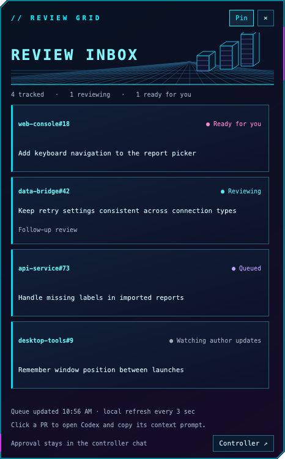

# Review Grid

A neon desktop inbox for pull-request reviews: cyan wireframes, magenta edges, and a quiet synthwave grid.



Review Grid reads a local JSON queue produced by an external controller. Click a card to open an existing Codex chat and copy a context prompt. You choose whether to paste and send it. The queue producer and review controller are separate tools and are **not included**.

## Requirements

- Python 3.11 or later, with pip and venv.
- PySide6 6.12 or later, below 7 (installed with the package).
- A graphical desktop. Codex with a registered `codex://` URL handler is needed for chat navigation.

## Quick start

Start in the extracted or cloned `reviewgrid` source directory. The demo needs no credentials or controller configuration; clicking a card without a controller shows a configuration message.

### macOS / Linux (bash or zsh)

```sh
python3 -m venv .venv
.venv/bin/python -m pip install -e .
.venv/bin/reviewgrid --state examples/state.json
```

### Windows (PowerShell)

```powershell
py -3 -m venv .venv
.\.venv\Scripts\python.exe -m pip install -e .
.\.venv\Scripts\reviewgrid.exe --state examples/state.json
```

These commands use the virtual environment directly, so shell activation is optional. You can also run `python -m reviewgrid` with that environment's Python.

## Using it

Drag the top brand area to move the window. **Pin** keeps it above other windows; **×** closes it. Position and pin preference are saved through Qt settings.

Cards are sorted by status, then PR key. Ready cards open the configured controller chat. Other cards open their valid `session_id` chat, falling back to the controller. **Controller ↗** opens the controller directly. Card actions copy a prompt to your clipboard, replacing its previous text, and never send it automatically.

The app rereads the local queue every three seconds. If the file disappears or becomes invalid, it keeps the last good list and shows an error while retrying. It does not poll GitHub, generate reviews, write the queue, or post comments. Its wireframe art is static; there is no animation timer.

## Configuration

| Setting | CLI flag | Environment variable | Default |
| --- | --- | --- | --- |
| Queue file | `--state` | `REVIEWGRID_STATE` | `~/.config/reviewgrid/state.json` |
| Controller chat UUID | `--controller-thread` | `REVIEWGRID_CONTROLLER` | Unset |

CLI flags override environment variables. Supply the UUID of your own existing Codex controller chat, for example by setting `REVIEWGRID_CONTROLLER` in your shell. A missing or invalid destination produces a visible configuration error. The synthetic UUIDs in tests are fixtures, not usable chats.

Only one instance per resolved queue path is intended to run; launching the same queue again asks the existing window to focus. Different queues can have separate windows, but share the position and pin preferences.

## Queue format

The top-level object must contain a `prs` object keyed by `owner/repository#number`. See [the complete synthetic demo](examples/state.json).

```json
{
  "prs": {
    "example/desktop-tools#9": {
      "title": "Remember window position between launches",
      "status": "reviewing",
      "head_sha": "aaaaaaaaaaaaaaaaaaaaaaaaaaaaaaaaaaaaaaaa",
      "kind": "followup"
    }
  }
}
```

| Field | Meaning |
| --- | --- |
| `status` | Required recognized status from the table below. |
| `title` | Optional plain text; falls back to the PR key. |
| `session_id` | Optional UUID of an existing Codex review chat. Invalid values fall back to the controller. |
| `head_sha` | Optional revision context included in the copied prompt; no remote validation is performed. |
| `kind` | Optional; `followup` adds a follow-up label. |
| `archived_from` | For `archived` records, only `posted` remains visible. |

| Status | Display |
| --- | --- |
| `awaiting-approval` | Ready for you |
| `clean` | Ready to approve |
| `failed`, `stuck` | Needs attention |
| `reviewing` | Reviewing |
| `card`, `pending` | Queued |
| `stale` | Head changed |
| `posted` | Watching author updates |

Unknown statuses and malformed records are skipped. Queues larger than 2,000,000 bytes are rejected. Producers should replace the JSON file atomically to avoid partial reads. Keep actual queue files outside this repository; the included example is entirely synthetic.

## Development and verification

After installing, run the tests from the source directory.

macOS / Linux:

```sh
QT_QPA_PLATFORM=offscreen .venv/bin/python -m unittest discover -s tests -v
```

Windows PowerShell:

```powershell
$env:QT_QPA_PLATFORM = "offscreen"
.\.venv\Scripts\python.exe -m unittest discover -s tests -v
Remove-Item Env:QT_QPA_PLATFORM
```

The tests cover queue filtering and ordering, chat destination selection, prompt copying without queue writes, error retention, and room for wrapped card titles. The screenshot uses the synthetic demo and isolated temporary settings.

## Platform limits

The original widget was used on macOS. This standalone package has been checked with offscreen Qt on macOS; native Windows and Linux window behavior is untested. Fonts fall back when Menlo is unavailable, so appearance can vary. Frameless dragging, always-on-top behavior, and Codex URL handling depend on the desktop environment. There is no bundled installer, autostart setup, controller, or GitHub integration.
